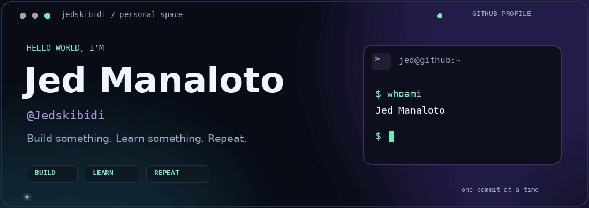
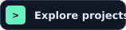
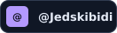
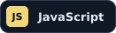
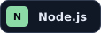
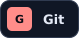
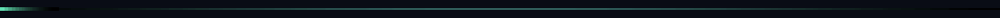

<!-- Personal GitHub profile for Jed Manaloto / Jedskibidi. -->

  

   
   

  
  &nbsp;
  

 

## Hey, I'm Jed 👋

I turn ideas into web projects and learn as I build. This is my little corner of GitHub for experiments, progress, and things I'm proud to share.

- 💻 **Focus:** web development and interfaces that feel good to use.
- 🌱 **Exploring:** Node.js and responsive design.
- 🛠️ **Building:** [Moodoro](https://github.com/Jedskibidi/Moodoro).
- ⚡ **My approach:** build, learn, improve, repeat.

 

## My toolbox

  
  
  
  
  
  

 

## Currently in the editor

### [🍅 Moodoro](https://github.com/Jedskibidi/Moodoro)

A web app I'm building and refining, one update at a time.

**What I'm working on:** responsive layouts, cleaner styling, and a smoother experience across screen sizes.

[Take a look at the project →](https://github.com/Jedskibidi/Moodoro)

 

  
   
  <strong>Small commits. Steady progress.</strong>

